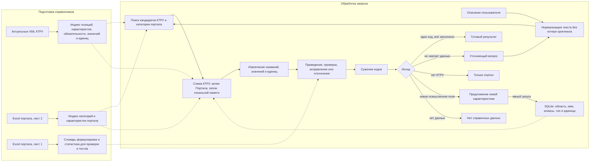

# Tender Hack Казань 2026

Кейс «Автозаполнение ключевых характеристик в СТЕ» решает задачу подготовки
структурированного описания товара. Пользователь пишет свободный текст, а сервис выделяет
характеристики, приводит их к справочному виду, исправляет объяснимые ошибки и помогает
дойти до конечного кода КТРУ.

СТЕ из выгрузок нужны как примеры реальных товаров и реального качества данных. Сервис не
создаёт, не редактирует и не хранит СТЕ.

## Что должна делать система

На вход приходит описание товара на естественном языке. В нём могут быть опечатки,
синонимы, неверные единицы, невозможные значения, лишние свойства и пропуски.

Система должна:

1. Понять, о каком товаре идёт речь, и найти подходящие позиции КТРУ.
2. Выделить из текста характеристики и их значения.
3. Сопоставить их с унифицированными характеристиками КТРУ и портала.
4. Привести названия, значения и единицы измерения к справочному виду.
5. Исправить только однозначные ошибки. Показать исходный фрагмент, исправление и причину.
6. Убрать из результата характеристику, которая не относится к товару или не может быть
   обоснованно сопоставлена. Объяснить, почему она отклонена.
7. Показать, какие характеристики пришли из КТРУ, а какие из портала.
8. Поэтапно показать сужение кандидатов до конечного кода КТРУ.
9. Запросить значения обязательных характеристик КТРУ, которых нет в тексте.
10. Честно сообщить, если товар отсутствует в КТРУ, а при необходимости и в справочнике
    портала.
11. Сохранить новую осмысленную характеристику в области этого вида товара и использовать
    её в следующих запросах после КТРУ и Портала.

Сервис ничего не додумывает. Допустимое значение из справочника не означает, что
пользователь выбрал именно его.

## Приоритет источников

| Приоритет | Источник | Как используется |
|---|---|---|
| 1 | КТРУ | Название характеристики, обязательность, допустимые значения, диапазоны и единица измерения для выбранной позиции |
| 2 | Справочник портала, лист 2 Excel | Дополнительные характеристики категории, которых нет в КТРУ |
| 3 | Локально выученная схема | Новые характеристики, ранее подтверждённые для того же семейства КТРУ, категории Портала или вида товара |
| Данные для проверки | Товары портала, лист 1 Excel | Реальные формулировки, синонимы, опечатки, распределения значений и тестовые примеры |

Если одна и та же характеристика есть в КТРУ и на портале, всегда побеждает КТРУ. Портал
не может переименовать поле КТРУ, изменить его единицу или расширить допустимые значения.

Если характеристика есть только на портале и подходит найденной категории товара, она
попадает в результат с источником «Портал». Если поля нет в обоих справочниках, система
проверяет его осмысленность и связь с товаром. Осмысленное поле возвращается с источником
«Новая» и после явного нажатия «Подобрать» сохраняется как схема без исходного запроса и
конкретного значения. В следующих запросах той же области оно имеет источник «Из опыта».
Мусор, коммерческие поля и признаки другого товара отклоняются с причиной и никогда не
попадают в память.

Выученная характеристика не может переопределить КТРУ или Портал. Если справочники позже
получили одноимённое поле, локальная запись остаётся в базе, но перестаёт участвовать в
ответе.

## Возможные результаты запроса

| Ситуация | Результат |
|---|---|
| Найден один код КТРУ, все обязательные значения указаны | Код и унифицированные характеристики |
| Кодов несколько | Короткий вопрос по характеристике, которая лучше всего различает кандидатов |
| Код найден, но обязательных значений не хватает | Код-кандидат, заполненная часть и вопросы только по пропущенным обязательным характеристикам |
| В КТРУ товара нет, но есть категория портала | Режим «Только портал»: характеристики портала без выдуманного кода КТРУ |
| Нет КТРУ и Портала, но указан понятный вид товара и новая характеристика | Режим «Локальная схема»: новая характеристика сохраняется в области этого вида товара |
| Нет ни справочных данных, ни осмысленных характеристик | Сообщение «Нет справочных данных», отклонённые фрагменты и просьба уточнить вид товара |

Отсутствующая необязательная характеристика КТРУ не заполняется и сама по себе не вызывает
вопрос. Исключение: характеристика нужна, чтобы различить несколько кодов. Тогда система
объясняет, зачем задаёт вопрос.

## Что видит пользователь

- исходный текст с подчёркнутыми исправленными и отклонёнными фрагментами;
- шаги сужения и количество оставшихся кодов после каждого шага;
- таблицу «Характеристика, значение, единица, источник, обязательность»;
- для каждой правки: что было, что стало и почему;
- отдельный список удалённых характеристик с причиной;
- состояние новых характеристик: будет сохранена, сохранена, использована снова или не
  сохранена с причиной;
- вопросы по недостающим обязательным характеристикам;
- конечный код КТРУ либо явный статус, почему кода нет.

## Потоки данных

Справочники готовятся заранее. При обработке в базу может попасть только подтверждённая
схема новой характеристики. Описание товара и полный результат не сохраняются.



### Этапы онлайн-пайплайна

| Этап | Вход | Выход |
|---|---|---|
| 1. Проверка запроса | Сырой текст | Ошибка для пустого или слишком длинного ввода либо принятый текст |
| 2. Нормализация | Принятый текст | Регистр, раскладка и типографика приведены для поиска, оригинал сохранён для подсветки |
| 3. Поиск кандидатов | Нормализованный текст | Ранжированный список конечных позиций КТРУ и категорий портала |
| 4. Построение схемы | Кандидаты и область товара | Приоритетное объединение КТРУ, Портала и локально выученных характеристик |
| 5. Извлечение | Текст и схема | Фрагменты текста, сопоставленные с характеристиками и сырыми значениями |
| 6. Приведение | Извлечённые значения | Справочные названия, значения и единицы. Например, 110 см превращается в 1100 мм, если КТРУ требует миллиметры |
| 7. Проверка | Приведённые данные | Принято, исправлено, требуется подтверждение, предложено к сохранению или отклонено. У каждого решения есть причина |
| 8. Сужение | Кандидаты и принятые характеристики | Оставшиеся коды и видимые шаги исключения |
| 9. Диалог | Несколько кодов или пропуски | Один различающий вопрос либо пакет вопросов по обязательным полям выбранного кода |
| 10. Ответ | Выбранный исход | Полный структурированный ответ: характеристики, источники, исправленный текст, мусор, вопросы и решения памяти |
| 11. Обучение | Новые осмысленные поля при явном запуске | Только нормализованная схема характеристики в узкой области товара |

Сначала задаются вопросы, необходимые для выбора кода. После выбора кода проверяется полный
набор его обязательных характеристик. Это не позволяет спрашивать пользователя обо всех
обязательных полях сразу у десятков неподходящих кандидатов.

## Варианты реализации

### Вариант A. Детерминированный baseline

Это вариант, который можно гарантированно довести до работающего демо. «Работает всегда»
означает, что на любой ввод он возвращает корректный тип результата: ответ, вопрос, режим
«Только портал» или честный отказ. Это не обещание стопроцентной смысловой точности.

- поиск кандидатов: BM25 или TF-IDF по названию позиции, ОКПД2, фиксированным значениям и
  словарю формулировок портала;
- исправление раскладки и опечаток: словари и нечёткое сравнение с порогом;
- извлечение: самые длинные совпадения названий и значений, регулярные выражения для чисел
  и единиц;
- конвертация: таблица совместимых единиц и точные коэффициенты;
- проверка: допустимые списки и диапазоны КТРУ, затем статистические границы портала;
- сужение: последовательная фильтрация кандидатов по принятым значениям;
- вопрос: сначала различающая характеристика, затем недостающие обязательные поля;
- объяснение: готовые шаблоны для каждого правила.

Плюсы: быстро, прозрачно, легко тестировать, не требует GPU. Минусы: хуже понимает свободные
перефразы и сложные предложения.

### Вариант B. Семантический и элегантный

Система совместно оценивает код и характеристики, но последний шаг всё равно остаётся
детерминированным.

1. Легковесная открытая модель представлений ищет семантически близкие позиции КТРУ и
   категории портала.
2. Для найденных кандидатов динамически строится разрешённая схема характеристик.
3. Небольшая открытая модель или токен-классификатор извлекает данные только в эту схему.
4. Совместная функция оценки учитывает близость текста, совместимость значений, источник,
   обязательность и найденные ошибки.
5. Следующий вопрос выбирается по ожидаемому сокращению числа кандидатов.
6. Значения, единицы, диапазоны и обязательность проверяются обычным кодом, а не моделью.
7. Новое поле проходит отдельный классификатор полезности и дедупликацию с тремя слоями
   схемы, а в векторный индекс попадает только после сохранения канонического определения.

Плюсы: лучше понимает синонимы и контекст, одна схема объясняет подбор кода и полей.
Минусы: нужны разметка, калибровка уверенности и контроль галлюцинаций. Вариант принимается
только после сравнения с baseline на одном и том же эталоне.

### Вариант C. Рекомендуемый гибрид

Сначала реализуется вариант A как безопасный контур. Затем семантический поиск из варианта
B заменяет только поиск кандидатов и сопоставление сложных фраз. Все проверки, единицы,
приоритет источников, обязательные вопросы и отказы остаются детерминированными.

Так можно улучшать понимание текста без риска, что модель придумает характеристику или
молча изменит правило КТРУ. Компонент включается только если повышает качество на закрытом
тестовом наборе и не увеличивает долю молча неверных ответов.

В прототипе реализован именно этот вариант. Сейчас семантический поиск использует лёгкое
разреженное представление слов, исправление раскладки, словарь понятий и нечёткое
сходство. Контракты шагов не зависят от реализации: retrieve, interpret и decide можно
заменить на BM25, sentence-transformer с открытыми весами или обученный экстрактор, не
меняя HTTP, правила источников, память и интерфейс.

## Контракт результата

| Поле | Смысл |
|---|---|
| status | ready, needs_input, portal_only, learned_only или not_found |
| steps | Шаги сужения и число оставшихся кандидатов |
| code | Конечный код КТРУ или null |
| chars | Принятые унифицированные характеристики с координатами исходного фрагмента |
| edits, corrected_text | Точные исправления и целиком исправленное описание |
| rejected | Удалённые или нераспознанные фрагменты с причиной |
| missing_required | Обязательные характеристики выбранного КТРУ без значения |
| questions | Конкретные вопросы и допустимые варианты, если они заданы справочником |
| candidates | Кандидаты и уверенность для объяснения неоднозначности |
| learning | Для каждого нового поля: pending, created, updated, reused, rejected или failed |
| portal_category | Выбранная конечная категория Портала или null |
| implementation | Идентификатор подставленной реализации шагов |

У каждой принятой характеристики есть исходный фрагмент, унифицированное имя, значение,
единица, источник «КТРУ», «Портал», «Новая» или «Из опыта», признак обязательности и статус
преобразования. Принятые и отклонённые фрагменты разделены и не смешиваются.

## Хранение данных

Для новых характеристик используется SQLite в data/runtime/learned.sqlite3. Каталог data/
не попадает в git. Предпросмотр при вводе отправляет learn=false и никогда не пишет в базу.
Явная кнопка «Подобрать» отправляет learn=true и атомарно сохраняет только безопасное новое
поле.

Хранятся:

- узкая область: семейство КТРУ, конечная категория Портала или нормализованный вид товара;
- каноническое имя и алиасы характеристики;
- тип значения и каноническая единица;
- счётчик подтверждений и служебный идентификатор.

Не сохраняются:

- описания пользователей;
- конкретные значения характеристик из запросов;
- найденные коды и полные результаты;
- исправления, отклонения и вопросы;
- карточки или идентификаторы СТЕ;
- история диалога.

Запись делается транзакцией BEGIN IMMEDIATE, включены WAL и busy timeout. Одновременное
подтверждение одной пары «область и имя» даёт одну строку, сливает алиасы и увеличивает
счётчик. Ошибка базы не ломает основной ответ: решение learning получает failed. Текст и
содержимое результата в логи не попадают.

## Тестирование

### Наборы

1. Ручной эталон: описание, допустимые коды, унифицированные характеристики, обязательные
   пропуски, исправления и отклонения.
2. Реальные примеры: обезличенные строки с первого листа выгрузок портала, размеченные
   вручную.
3. Синтетические искажения: опечатки, неверная раскладка, синонимы, перестановка слов,
   совместимые единицы и значения на границах диапазона.
4. Отрицательные примеры: товар вне КТРУ, товар только из портала, товар вне обоих
   справочников и характеристика от другого типа товара.
5. Сценарии из нескольких запросов с изолированной базой: сначала новое поле, затем его
   повторное использование, перезапуск процесса и проверка отсутствия утечки между
   товарами.

Разделение на обучение и тест делается по семейству или шаблону КТРУ. Близкие позиции одного
шаблона не должны оказаться по разные стороны, иначе результат будет завышен. Данные
организаторов и эталонные примеры хранятся только в data/ и не попадают в git.

### Обязательные сценарии

| Сценарий | Что проверяем |
|---|---|
| Полное корректное описание | Код, значения, единицы и источники совпадают с эталоном |
| Пустой и слишком длинный ввод | Понятная ошибка без запуска пайплайна |
| Опечатка и неверная раскладка | Ошибка исправлена либо запрошено подтверждение, исходный фрагмент подчёркнут |
| 110 см и 1100 мм | Одинаковое унифицированное значение и одинаковый код |
| Граница диапазона | Учитываются строгие и нестрогие границы КТРУ |
| Несуществующее значение | Значение не принимается молча, есть причина и варианты исправления |
| Характеристика другого товара | Поле удалено, причина отображается |
| Нет обязательной характеристики | Она не заполняется автоматически, формируется вопрос |
| Нет необязательной характеристики | Вопрос не формируется |
| Несколько кодов | Задаётся вопрос, который различает кандидатов |
| Нет позиции КТРУ | Выбран portal_only или not_found, код не выдуман |
| Нет категории портала | Осмысленное новое поле получает область вида товара, мусор даёт not_found |
| Новая характеристика, предпросмотр | source=new и pending, строк в памяти не добавилось |
| Новая характеристика, явный запуск | source=new и created, записана только схема |
| Следующий запрос | То же поле получает source=learned без повторной строки |
| Изоляция области | Поле стола не используется для кресла или дрона |
| Конфликт источников | КТРУ побеждает Портал и память, Портал побеждает память |
| Параллельное подтверждение | Одна строка, верный счётчик, нет потерянных обновлений |
| Повторный запрос с ответом | Кандидатов становится не больше, обязательный пропуск закрывается |
| Проверка хранения | В SQLite и логах нет текста, значения, мусора и полного результата |

Кроме обычных unit-тестов нужны контрактные тесты каждого этапа, сквозные сценарии через
HTTP и тесты на неизменность. Опечатка, другой регистр, перестановка слов и эквивалентная
единица не должны менять правильный смысл ответа.

## Метрики

Главный риск — молча выдать неправильный код или значение. Вопрос или честный отказ лучше
уверенной ошибки.

| Блок | Метрика | Что показывает |
|---|---|---|
| Сквозная | Safe end-to-end success | Доля случаев, где выбран правильный исход, код, характеристики, вопросы и отклонения |
| Безопасность | Silent critical error rate | Неверный код или значение без вопроса, предупреждения или отказа |
| Кандидаты | Recall@1, Recall@5, Recall@20, MRR | Попал ли правильный код в поиск и насколько высоко он стоит |
| Итоговый код | Exact accuracy и coverage | Точность среди выданных кодов и доля запросов, где система решилась выдать код |
| Характеристики | Macro F1 по парам «имя, значение» | Качество извлечения без доминирования частых полей |
| Нормализация | Exact match по значению и единице | Правильность справочного значения и пересчёта |
| Источник | Accuracy метки КТРУ, Портал, Новая или Из опыта | Соблюдение приоритета источников |
| Обязательность | Recall недостающих обязательных | Все ли обязательные пропуски превратились в вопросы |
| Правки | Precision и F0.5 | Лишняя правка штрафуется сильнее пропущенной |
| Отклонения | Precision, recall и over-deletion rate | Удаляем ли чужое и не удаляем ли полезное |
| Нет в справочнике | Accuracy исходов portal_only и not_found | Не выдумывает ли система КТРУ и портальные поля |
| Диалог | Успех после вопросов, среднее число вопросов | Доходит ли пользователь до результата без лишнего допроса |
| Память | Precision и recall записей, garbage-write rate | Не отравляем ли локальную схему мусором |
| Повторное использование | Reuse recall, duplicate rate, wrong-scope leakage | Узнаётся ли поле снова без дублей и утечки между товарами |
| Устойчивость памяти | Restart persistence и concurrent write failure rate | Работает ли знание после перезапуска и при параллельных запросах |
| Производительность | p50, p95 времени, RAM и VRAM | Пригодность для демонстрации и масштабирования |
| Приватность | Число найденных сохранённых запросов и результатов | Должно быть равно нулю |

Метрики считаются отдельно по одежде, мебели и инструментам, а также по чистым, неполным,
испорченным и внесправочным примерам. Для сравнения вариантов используется один и тот же
закрытый тестовый набор. Порог уверенности выбирается по кривой «покрытие против риска», а
не по максимальной общей точности.

Сценарный замер находится в scripts/measure_semantic.py. Один сценарий выполняется
последовательно с одной изолированной памятью, а между сценариями память сбрасывается. Это
важно: одношаговый набор не может проверить переход «new в первом запросе, learned во
втором» и легко скрывает утечку состояния.

В репозитории есть воспроизводимый синтетический набор без данных организаторов:

```bash
uv run python -m scripts.measure_semantic \
  examples/semantic_scenarios.json examples.semantic_runner:runner
```

Он покрывает КТРУ и Портал в одном ответе, исправления, единицы, мусор, обязательные
вопросы, неоднозначность, portal_only, товар вне обоих справочников, сохранение,
перезапуск, повторное использование и изоляцию области.

Текущий smoke-результат на 7 сценариях и 10 последовательных запросах: safe success 7/7;
F1 характеристик, источники, отклонения, исправления, вопросы, записи и повторное
использование 1,00; garbage-write, лишние вопросы, лишние правки, дубли, нарушение
приоритета и утечка области 0,00. Это проверка контракта на контролируемой синтетике, а не
оценка качества на скрытых данных организаторов.

## Словарь предметной области

| Термин | Значение в проекте |
|---|---|
| СТЕ | Стандартная товарная единица на портале. В этом проекте СТЕ служат примерами данных, система не управляет их карточками |
| КТРУ | Федеральный каталог товаров, работ и услуг с унифицированными позициями и характеристиками |
| Позиция КТРУ | Запись каталога с кодом, названием, характеристиками, значениями и единицами |
| Конечный код КТРУ | Наиболее конкретная позиция каталога. Это группа вариаций товара, а не одна модель или одна СТЕ |
| Шаблон КТРУ | Родительская позиция, объединяющая несколько конечных кодов |
| ОКПД2 | Классификатор видов продукции, связанный с позициями КТРУ и используемый для грубого отбора категории |
| КПГЗ | Классификатор предметов государственного заказа портала. Присутствует во втором листе Excel |
| Категория портала | Конечная категория КПГЗ со своим набором характеристик |
| Характеристика | Именованное свойство товара, например материал каркаса, высота или мощность |
| Обязательная характеристика | Поле КТРУ с признаком isRequired. Если значения нет, система обязана спросить пользователя |
| Необязательная характеристика | Поле КТРУ, которое включается только при наличии значения в тексте и обычно не требует вопроса |
| Унификация | Приведение разных формулировок одного свойства к имени, значению и единице выбранного справочника |
| Нормализация | Техническая подготовка текста или значения: регистр, пробелы, раскладка, формат числа |
| Конвертация единиц | Точный пересчёт совместимых единиц, например сантиметров в миллиметры |
| Источник характеристики | КТРУ, Портал, Новая или Из опыта. Показывает, чем обоснована итоговая схема поля |
| Новая характеристика | Осмысленное поле, которого нет в КТРУ, Портале и памяти этой области. До сохранения имеет source=new |
| Выученная характеристика | Ранее сохранённая локальная схема. Используется после КТРУ и Портала с source=learned |
| Область памяти | Семейство КТРУ, категория Портала или нормализованный вид товара, внутри которого действует локальное поле |
| Предложение обучения | Каноническое имя, тип, единица и область без исходного текста и конкретного значения |
| Отравление памяти | Сохранение мусора, коммерческого поля или характеристики другого товара |
| Кандидат | Позиция КТРУ или категория портала, ещё не исключённая по введённым данным |
| Сужение | Последовательное исключение кандидатов по названию и характеристикам |
| Исправление | Однозначное изменение опечатки, единицы или значения с показом причины |
| Отклонённая характеристика | Фрагмент, который не относится к товару, противоречит справочнику или не сопоставлен достаточно уверенно |
| Уточняющий вопрос | Запрос значения, необходимого для выбора кода или заполнения обязательной характеристики |
| Отказ | Безопасный исход, когда данных недостаточно или подходящего справочника нет |

## Запуск текущего прототипа

1. Установить зависимости:

   ```bash
   uv sync
   ```

2. Распаковать архив организаторов «Казань 2026.zip» в data/raw/, внутри него распаковать
   архив КТРУ и собрать справочники. Данные организаторов в git не лежат.

   ```bash
   unzip "data/raw/Казань 2026.zip" -d data/raw
   unzip "data/raw/Казань 2026/КТРУ/КТРУ xml.zip" -d "data/raw/Казань 2026/КТРУ"
   uv run python scripts/build_ktru_actual.py
   uv run python -m scripts.build_portal
   ```

3. Прогнать текст через пайплайн:

   ```bash
   uv run python -m pipeline.run "Стол письменный деревянный, столешница ЛДСП 22 мм"
   ```

4. Запустить веб-интерфейс и открыть http://localhost:8000:

   ```bash
   uv run uvicorn web.server:app --host 0.0.0.0 --port 8000
   ```

## Перед слиянием

```bash
uv run ruff check .
uv run ruff format --check .
uv run ty check
uv run pytest
```

## Где что

| Где | Что |
|---|---|
| contracts/ | Типы данных и сигнатуры шагов |
| pipeline/semantic.py | Семантический гибрид и сменные шаги retrieve, interpret, decide |
| pipeline/memory.py | Локальная SQLite-память схем новых характеристик |
| pipeline/ | Базовые поиск кандидатов, извлечение, сужение, единицы и нормализация текста |
| web/ | Сервер и страница подбора |
| scripts/measure_semantic.py | Сценарные метрики характеристик, источников, мусора, правок, вопросов и памяти |
| scripts/ | Сборка, загрузка справочников и замеры |
| tests/test_semantic.py | Сквозные примеры КТРУ, Портала, памяти, мусора, исправлений и сменных шагов |
| tests/ | Unit-тесты, контрактные и сквозные проверки |
| docs/task.md | Критерии и ограничения хакатона |
| docs/data.md | Устройство исходных данных |
| docs/data-findings.md | Результаты анализа справочников и выгрузок |
