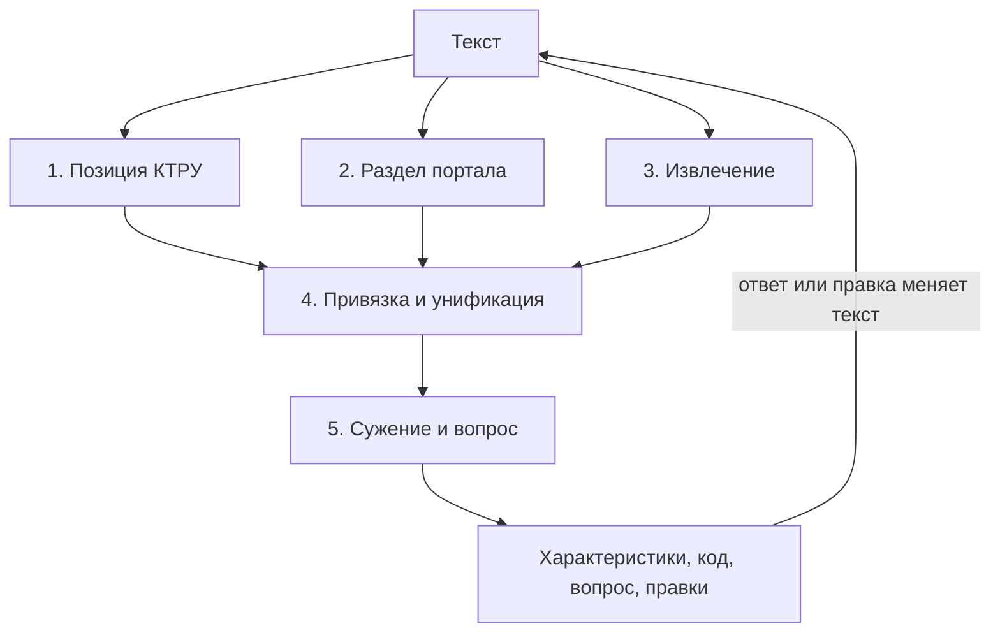

# Архитектура

Термины: **категория** — одна из трёх (одежда, мебель, инструменты); **товар** — то, что
описывает пользователь; **раздел портала** —
конечная категория портала из листа 2 выгрузок («Тумбы офисные деревянные»).

## Решения
- Главное — разложить характеристики из описания по трём уровням и унифицировать их:
  КТРУ, характеристики СТЕ портала, новые хорошие. На выходе набор унифицированных
  характеристик, а не СТЕ.
- Код КТРУ определяется по ходу: он нужен, чтобы знать характеристики первого уровня.
- Унификация названий, значений и единиц — центральная часть, а не побочная.
- Второй уровень берём только из листа 2 выгрузок. Лист 1 — только для проверки.
- LLM не используем. Только справочник КТРУ, выгрузки портала, правила и математика.
  Ответ за десятые доли секунды на обычном процессоре.
- Знания берутся из КТРУ и портала, ручных списков нет. Этап честно отказывается, когда
  не уверен: лучше вопрос или пометка, чем молча неверное значение.
- Оценивают судьи глазами на своих текстах. Поэтому главное: на любой разумной фразе
  из трёх категорий характеристики собираются без странностей и с объяснениями.


## Что на выходе
| Блок | Что в нём |
|---|---|
| Категория и позиция КТРУ | одежда, мебель или инструменты; позиция и конечный код, если определён |
| Характеристики КТРУ | название, значение, единица как в КТРУ; во что превратился кусок текста; в какое значение КТРУ попало число («500 г → 0,5 кг, вариант 0,4–0,6 кг»); обязательная или нет |
| Характеристики СТЕ портала | то, чего нет в КТРУ, под единым названием раздела портала |
| Новые | разумные свойства, которых нет нигде; единое название; пометка «на одобрение модератору» |
| Не хватает | обязательные характеристики КТРУ, которых нет в тексте, со списком значений |
| Вопрос | если код не определён: характеристика, которая лучше всего различает оставшиеся коды |
| Правки | было → стало, почему; уверенное исправлено, сомнительное помечено |

Всё можно править. Правка переписывает описание, и характеристики собираются заново: текст остаётся
единственным источником правды.


## Одна идея: зашумлённый канал
У товара есть истина: позиция КТРУ и правильные значения характеристик. Пользователь
пишет текст и по дороге портит истину. Ищем самую вероятную истину и ту порчу, которая
объясняет текст.

| Порча | Пример |
|---|---|
| формат | «110 см.», «КРАСНЫЙ», лишние нули |
| синоним | «вес» вместо «масса», «тумбочка» вместо «тумба» |
| опечатка | «деревяный» |
| раскладка, двойники букв | «cnjk» → «стол», латинская «а» в русском слове |
| единица | 1100 мм при единице КТРУ см, потерянная единица |
| невозможное значение | «стол 5 м», значение не из списка КТРУ |
| пропуск | обязательной характеристики нет в тексте |

$$
(\hat p,\ \hat a,\ \hat o) = \arg\max_{p,\ a,\ o_{1..J}}\ P(p)\ P(a \mid p) \prod_{j} P(z_j \mid a, o_j)\ \pi(o_j)
$$

Здесь p это позиция КТРУ, a значения характеристик, z_j фрагменты текста, o_j порча
фрагмента, π(o) её априорная частота.

Что из этого следует:
- **Объяснение правки и есть найденная порча.** «1100 мм → 110 см: перепутана единица».
- **Вопрос пользователю выбирается по формуле**: характеристика с наибольшим приростом
  информации о коде.


## Этапы
Этапы нужны, чтобы у каждого был свой эталон, простой бейзлайн и метрика, и его можно
было улучшать отдельно. Граница этапа стоит там, где правильный ответ добывается из
наших данных без ручной разметки. В тестах этап получает правильный вход, а не выход
соседа. Этапы общаются только через contracts/. Справочник собирается заранее
и читается всеми этапами.



| Этап | Вход → выход | Откуда эталон | Бейзлайн | Метрика |
|---|---|---|---|---|
| 1. Позиция КТРУ | текст → коды с вероятностями | тексты из генератора | совпадение слов с названием позиции | шаблон в топ-1 и топ-5, MRR, категория; чистые и с порчей отдельно |
| 2. Раздел портала | текст → раздел листа 2 | тексты из названия раздела и его характеристик | совпадение слов с названием раздела | угадан, отказ, верно среди ответивших |
| 3. Извлечение | текст → куски «название?, значение, единица» с местом в тексте | лист 1: характеристики товара уже разделены « \| », склеиваем в текст и знаем границы | регулярки «число единица», «Название: значение» | полнота, точность, F1 пар; значение без названия отдельно |
| 4. Привязка и унификация | кусок + характеристики кандидатов → уровень, название, значение, единица, вид ошибки | генератор портит правильную пару и знает ответ; в листе 2 у базовых характеристик есть связанная эталонная, это готовые синонимы | точное совпадение без учёта регистра | название, значение, единица; правки: исправлено, ложные на чистых, F0.5, по видам порчи |
| 5. Сужение и вопрос | кандидаты + характеристики → код или вопрос, недостающие обязательные | генератор: со всеми значениями выходит исходный код, без части нужен вопрос | оставить коды, где все значения допустимы; спросить характеристику с наибольшим числом вариантов | код со всеми значениями; без одного: молча неверно, вопрос, код после ответа; недостающие обязательные |

Отказ и вопрос считаем отдельно от ошибки: молча неверное хуже честного «не знаю».
В правках точность важнее полноты, поэтому F0.5: ложная правка чистого значения хуже
пропущенной.

**Генератор** один на этапы 1, 4 и 5: позиция КТРУ → значения характеристик → текст
с порчей из таблицы выше. Он знает правильный ответ каждого этапа.

**Цикл.** Фидбек не ходит внутрь этапов, он только меняет текст: ответ на вопрос
дописывается к тексту, правка заменяет кусок, и всё считается заново. Тест цикла:
симулированный пользователь знает правду, отвечает на вопросы, метрика — сколько кругов
до кода.

**Категория** отдельным этапом не считается: она однозначно следует из позиции КТРУ или
раздела портала и показывается первой ступенью сужения.

### Справочник: scripts/build_ktru_actual.py, scripts/build_portal.py
- **КТРУ:** позиции трёх категорий, характеристики, значения, диапазоны, единицы,
  обязательность, родитель-шаблон, код ОКПД2.
- **Лист 2 портала:** характеристики каждого раздела портала с типом (эталонная,
  категорообразующая, базовая), видом значения, значениями и единицей. Эталонные
  и категорообразующие связаны с эталонным справочником и уже названы единообразно.
  Базовые — то, что заводили поставщики, с разнобоем и мусором.
- **Унификация листа 2** при сборке:
  - варианты одного свойства склеиваем: регистр, единица из названия в отдельное поле,
    похожие слова, одна и та же величина;
  - каноническое название — то, что встречается в большем числе разделов листа 2
    («Вес» в 121 разделе мебели против «Масса» в 40);
  - мусорные названия отбрасываем: с числом или значением внутри («4 выдвижных ящика»);
  - значения приводим так же: «есть / присутствует» → «Да».
- **Лист 1** в справочник не идёт, это товары для проверки.

### Где в коде
По файлу на этап: pipeline/candidates.py, section.py, extract.py, link.py, narrow.py.
Общие text.py и values.py. Генератор scripts/generate.py, метрики этапов scripts/stages.py,
сквозной замер с ответами на вопросы scripts/measure.py.


## Как проверяем
- **Фразы как у судей.** По 15–20 придуманных описаний на категорию: со свойствами вне
  КТРУ, синонимами, ошибками, пропусками. Прогоняем и смотрим глазами.
- **Товары листа 1.** На вход название и характеристики живого товара, смотрим, как
  разложены и унифицированы. Это согласие с живыми данными, а не точный эталон: кода
  КТРУ у них нет. Без данных тест пропускается.
- **Браузерный прогон.** Скрипт нажимает все кнопки страницы и сверяет экран с ответом
  сервера.
- **Тесты этапов.** pytest на каждую функцию: обычный случай и границы (пусто, опечатки,
  неполные данные, нет кандидатов, несколько кандидатов).
- **Замер** scripts/measure.py на эталоне: доля верных кодов и значений. Только для
  себя, на презентацию не выносим: жюри сказали, что метрики не цель.


## Сервис и запуск
- Сервер web/server.py на стандартной библиотеке: POST /api/run, статика страницы.
  Пайплайн в том же процессе, справочник грузится при старте.
- Страница web/static: HTML, CSS, JS без сборки, в стиле UI-кита портала.
- Docker: один контейнер, data/ монтируется томом, справочник собирается при старте,
  если его нет.

Запуск для жюри:
1. Положить архив организаторов в data/raw.
2. docker compose up --build.
3. Открыть http://localhost:8000.


## Репозиторий в конце

```
README.md                 запуск, схема, почему без LLM
docker-compose.yml, Dockerfile
pyproject.toml, uv.lock

contracts/                типы между этапами и API
pipeline/
  candidates.py           1. позиция КТРУ
  section.py              2. раздел портала
  extract.py              3. извлечение
  link.py                 4. привязка и унификация
  narrow.py               5. сужение, вопрос, недостающие
  run.py                  соединяет этапы
  text.py  values.py      общая нормализация текста и значений
web/
  server.py
  static/                 страница
scripts/
  build_ktru_actual.py    архив КТРУ → справочник
  build_portal.py         лист 2 выгрузок → характеристики разделов
  dataloader.py
  generate.py             тексты с известным ответом из КТРУ
  stages.py               метрика каждого этапа на правильном входе
  measure.py              сквозной замер с ответами на вопросы
tests/
docs/
  architecture.md  task.md  data.md
  bpmn.svg  presentation.pdf
```

В git нет: data/ (архивы, справочник, эталон), рабочие заметки.


## Порядок работы
1. Лист 2 в справочник с унификацией базовых.
2. Раздел портала для текста.
3. Разбор текста и раскладка по трём уровням, новые без мусора.
4. Характеристики по уровням главными на странице, код и сужение рядом.
5. Поиск позиции по словам не из КТРУ.
6. Число → вариант КТРУ, проверки по разделу портала.
7. Docker, фразы как у судей, BPMN и презентация.
