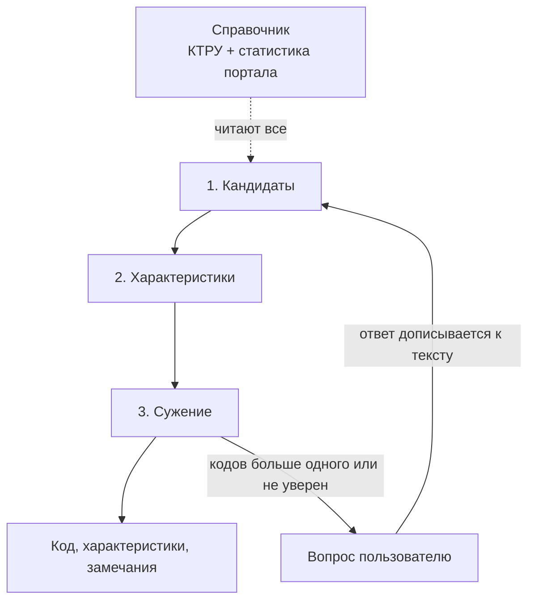

# Архитектура

## Решения
- LLM не используем. Только справочник, статистика портала, классический ML и математика.
- Главная фича: каждый этап мерится отдельно, улучшения идут по цифрам и видны в журнале.
- Красивое решение: одна понятная идея, знания берутся из КТРУ и портала, ручных списков нет,
  этап честно отказывается, когда не уверен.


## Одна идея: зашумлённый канал
У товара есть истина: конечный код КТРУ и правильные значения характеристик. Пользователь
пишет текст и по дороге портит истину. Ищем самую вероятную истину и ту порчу, которая
объясняет текст.

| Порча | Пример |
|---|---|
| формат | «110 см.», «КРАСНЫЙ», лишние нули |
| синоним | «вес» вместо «масса», «липучка» вместо «застёжка-контакт» |
| опечатка | «дсп» → «ДСП», «деревяный» |
| раскладка, двойники букв | «cnjk» → «стол», латинская «а» в русском слове |
| единица | 1100 мм при диапазоне в см, потерянная единица |
| невозможное значение | «стол 5 м», значение не из списка КТРУ |
| чужое поле | ширина записана как высота |
| пропуск | обязательной характеристики нет в тексте |

$$
(\hat p,\ \hat a,\ \hat o) = \arg\max_{p,\ a,\ o_{1..J}}\ P(p)\ P(a \mid p) \prod_{j} P(z_j \mid a, o_j)\ \pi(o_j)
$$

Здесь p это код КТРУ, a это значения характеристик, z_j фрагменты текста, o_j порча
фрагмента, π(o) её априорная частота.

Что из этого следует:
- **Объяснение правки и есть найденная порча.** «1100 мм → 110 см: перепутана единица».
- **Разметка бесплатно.** Берём чистые значения КТРУ, портим своими операторами и получаем
  примеры с известным ответом для тестов приведения и проверок.
- **Вопрос пользователю выбирается по формуле**: характеристика с наибольшим приростом
  информации о коде.


## Этапы
Три этапа, как в pipeline/run.py. Этапы общаются только через contracts/, поэтому внутри
этапа можно дробить и переписывать что угодно, соседи этого не заметят. Справочник
собирается заранее и читается всеми этапами: позиции КТРУ, допустимые значения, диапазоны,
единицы; по порталу частоты значений, обычные диапазоны чисел, синонимы.



### 1. Кандидаты: pipeline/candidates.py
Текст → категория и вероятности конечных кодов.
- Нормализация: раскладка, латинские двойники русских букв, регистр.
- Поиск кодов: BM25 или наивный Байес по названиям КТРУ и карточкам портала.
- Вероятности и отказ: если уверенность ниже порога, кандидатов больше, но не пусто.

Метрика: эталонный код в топ-k, точность категории.

### 2. Характеристики: pipeline/chars.py
Текст и кандидаты → характеристики со значениями, источником и найденной порчей.
- Извлечение: сырые фрагменты, грамматика «число + единица», словарь значений.
- Приведение: фрагмент → значение КТРУ через самую дешёвую порчу (опечатка, пересчёт
  единиц, синоним из портала), или отказ.
- Проверки: значение вне диапазона КТРУ или вне обычного распределения по порталу,
  несовместимые пары, противоречия.
- Источник: КТРУ, если характеристика есть в справочнике кода; портал, если её нет в КТРУ,
  но она частая в выгрузках категории; иначе новая.

Метрика: точность и полнота значений, доля молча неверных, точность замечаний на
испорченных примерах.

### 3. Сужение: pipeline/narrow.py
Кандидаты и характеристики → код, вопрос или «не нашли».
- Отсев кодов, которые противоречат найденным значениям, с записью шагов.
- Вероятности оставшихся кодов и энтропия выбора.
- Вопрос по характеристике с наибольшим приростом информации, варианты по частоте.
- Недостающие обязательные характеристики и замечания из найденных порч.

Метрика: точность кода, среднее число вопросов.


## Как улучшаем качество
- **Свой эталон у каждого этапа.** На вход этапу подаётся эталон, поэтому ошибки соседей на
  его метрику не влияют.
- **Оракульная лесенка.** Заменяем этапы эталоном по очереди и смотрим, на каком этапе
  теряется больше всего точности кода. Его и улучшаем следующим.
- **Варианты по имени.** Новая идея кладётся рядом с этапом в pipeline/<этап>_<идея>.py с той
  же сигнатурой. Замер сравнивает её с текущим вариантом. Победитель становится основным,
  только если растёт метрика этапа и не падает сквозная. Проигравшие удаляем, их цифры
  остаются в журнале.
- **Испорченные примеры генерируются.** Операторы порчи из таблицы выше применяются к чистым
  значениям КТРУ. Тот же список операторов этап характеристик разбирает обратно. Частоты
  операторов π(o) считаем по товарам портала (хвосты .00000, варианты единиц, латинские
  буквы, опечатки в названиях), поэтому синтетика портится так же, как живой текст.
- **Реальные грязные данные.** Товары портала (лист 1 выгрузок, около 300 тысяч) это живая
  грязь, но без кода КТРУ и правильных значений. Используем их так, как описано в таблице
  наборов ниже.
- **Журнал экспериментов** в docs/experiments.md: идея, гипотеза, метрика до и после, вывод.
  На защите это график «как росло качество по этапам».

### Наборы для замера
| Набор | Откуда | Что меряет |
|---|---|---|
| Чистый эталон | написан руками, 30 шт. | точность кода и характеристик |
| Реальный эталон | товары портала, код и значения размечены руками по zakupki.mos.ru, 30–50 шт. | то же на живом тексте |
| Согласие с карточкой | товары портала, тысячи: на вход только название, ответ это характеристики из карточки | извлечение и приведение, как согласие, а не точность: в карточке тоже бывают ошибки |
| Выбросы | товары портала со значениями далеко от распределения категории, 50–100 размечены руками | проверки невозможных значений |
| Синтетика | значения КТРУ, испорченные с частотами портала | приведение, опечатки, единицы |
| Живой поток | 1–2 тысячи случайных товаров портала без ответов | доля кода, вопросов и «не нашли», падения, время |

Все наборы лежат в data/eval/ и в git не попадают.


## Метрики и тесты

### Главная метрика
**Молча неверный ответ**: сервис уверенно выдал неверное, без вопроса и без замечания. Это
хуже вопроса и хуже «не знаю». Считаем на каждом этапе: молча неверный код, молча неверное
значение, молча пропущенная ошибка. Держим около нуля, остальные метрики поднимаем.

### Метрики этапов
**1. Кандидаты**

| Метрика | Зачем |
|---|---|
| Recall@k, k = 1, 5, 20 | правильного кода нет в кандидатах, значит дальше его не спасти |
| MRR | насколько высоко стоит правильный код |
| Точность на уровнях ОКПД2, шаблон, конечный код | код иерархический: верный шаблон лучше промаха мимо |
| Калибровка: Brier, ECE | по вероятностям решаем, отвечать или спрашивать |
| AUGRC | средний риск незамеченной ошибки по всем порогам отказа; порог выбираем по кривой, а не одной точкой |
| Доля перевёрнутых пар | как часто у неверного ответа уверенность выше, чем у верного |

**2. Характеристики**

| Метрика | Зачем |
|---|---|
| Precision, recall, F1 по парам «характеристика и значение», макро по характеристикам | частые характеристики не забивают редкие |
| Пустые ответы в счёте | значения нет в тексте и мы не вписали: верно; вписали: ложная находка |
| Точность значения при верной характеристике | отделяет ошибки приведения от ошибок извлечения |
| Точность единиц и пересчёта | числа |
| Точность метки источника | КТРУ, портал, новая |
| Согласие с карточкой портала | реальные товары без разметки |

**3. Ошибки и правки**

| Метрика | Зачем |
|---|---|
| Precision, recall, F0.5 обнаружения | F0.5 весит точность вдвое: лишняя правка хуже пропущенной |
| Precision, recall, F0.5 исправления | нашли и исправили на правильное значение |
| Ложные тревоги на чистом | замечания на чистом эталоне, около нуля |
| Разбивка по видам порчи | опечатка, раскладка, единица, синоним, невозможное значение, чужое поле |
| Точность объяснения | верно ли определён вид порчи, матрица ошибок по видам |
| PR-AUC проверок | качество поиска выбросов при любом пороге |

**4. Сужение и код**

| Метрика | Зачем |
|---|---|
| Точность кода без вопросов и после диалога с симулированным пользователем | |
| Среднее число вопросов, доля диалогов с вопросом | |
| Бит на вопрос: прирост информации заданного вопроса против лучшего возможного | качество выбора вопроса |
| Сводная: верный код минус штраф за ошибку и за каждый вопрос | одно число для сравнения вариантов сужения |
| Кривая сужения: log₂ числа кандидатов после каждого шага | график для слайда |
| Recall недостающих обязательных | |
| Точность «не нашли» | товары вне КТРУ |

**5. Сервис**
- Время ответа через HTTP, медиана и 95-й перцентиль.
- Доля падений и распределение исходов (код, вопрос, «не нашли») на живом потоке.

### Статистика
- На 30 примерах один пример весит 3,3%. У каждой метрики показываем доверительный интервал
  (бутстрэп).
- Варианты сравниваем парно на тех же примерах: сколько исправил, сколько сломал. Побеждает
  только значимый выигрыш.

### Сложные примеры важнее лёгких
У каждого примера есть метки сложности по осям задачи. Метки ставятся по данным, а не по
тому, что решает наша модель.

| Ось | Значения |
|---|---|
| Порча | нет, одна, несколько |
| Вид порчи | опечатка, раскладка, единица, синоним, невозможное значение, чужое поле |
| Соседи | код один у шаблона; дети отличаются одной kind=1; набор kind=1 совпадает |
| Полнота | все обязательные; не хватает одной; почти пустой текст |
| Исход | код, вопрос, нет в КТРУ |
| Категория | одежда с медициной и спецзащитой, мебель, инструменты без категорообразующих |

Правила:
- **Квоты.** Лёгких (без порчи, один кандидат, всё есть) не больше 20%. По каждому значению
  каждой оси не меньше N примеров.
- **Отчёт по уровням.** Метрики показываем по уровням лёгкий, средний, трудный. Главная цифра
  считается на трудном уровне.
- **Без почти дублей.** Примеры группируются по паре «код и набор характеристик», одна группа
  даёт не больше двух примеров.
- **Новые примеры добираем там, где ошибается текущий вариант.** То, что он решает, уходит в
  лёгкие. Рядом всегда держим живой поток портала без отсева, иначе сравнение подстраивается
  под собственные слабости.
- **Тест на сам эталон.** Квоты выполнены, дублей нет, у каждого примера есть метки.

### Поведенческие тесты
Таблица: строки это умения (понимание текста, единицы, опечатки, раскладка, невозможные
значения, нехватка обязательных, сужение), столбцы это виды тестов. В клетке доля провалов.
- **Минимальные:** маленький целевой набор на одно умение, с ответами.
- **На неизменность:** порча, которая не меняет смысла, не меняет ответ. Опечатка, раскладка,
  перестановка слов, «110 см» и «1100 мм» дают тот же код и те же значения. Ответ для этого
  не нужен, поэтому гоняем на тысячах живых товаров портала.
- **На направление:** изменение двигает ответ в известную сторону. Добавили различающую
  характеристику, значит кандидатов не больше. Убрали обязательную, значит появился вопрос
  или она в списке недостающих. Вписали невозможное значение, значит появилось замечание.

### Тесты с планками
- tests/test_quality.py проверяет ключевые метрики против планок из tests/baselines.json.
  В этом файле только числа, данных там нет.
- Планки стоят на трудном уровне и на молча неверных ответах, а не на общей точности.
- Победил вариант, значит планку поднимаем. Откат ниже тест не пропустит.
- Если данных нет, тест пропускается, а не падает.
- История baselines.json в git и есть график роста качества для защиты.

### Откуда
Precision и recall с пустыми ответами: AdaTag, eCeLLM. F0.5 и раздельные обнаружение и
исправление: работы по исправлению опечаток, RuSpellEval. PR-AUC проверок: Auto-Test.
AUGRC: Traub et al., NeurIPS 2024. Вопросы по приросту информации: Yu et al., ACL 2019.
Квоты и вес трудных: HealthBench Professional. Отсев лёгкого: AFLite. Поведенческие тесты:
CheckList, ACL 2020.


## Проверки
Цикл улучшения живёт в Python-пайплайне. Сервер, фронт и Docker вызывают run() снаружи и на
него не влияют.

| Уровень | Что | Когда |
|---|---|---|
| Тесты этапов | pytest на каждый этап и каждый кусок внутри: обычный случай и границы (пусто, опечатки, неполные данные, нет кандидатов, несколько кандидатов). Функции вызываются напрямую | перед каждым слиянием |
| Замер качества | scripts/measure.py: метрики этапов на эталоне и испорченном наборе, оракульная лесенка, время пайплайна. Пайплайн вызывается напрямую, не через HTTP. Данные в data/, поэтому только локально | после каждого эксперимента |
| Сервис | tests/test_api.py на TestClient: ответ по контракту, пустой и длинный ввод дают 400. На фронте tsc и eslint | перед слиянием |
| Сборка | docker compose up --build, запрос к /api/health и к /api/run руками | перед сдачей |

Скорость мерим двумя числами: время пайплайна в замере (для улучшений) и время ответа через
HTTP к поднятому контейнеру, медиана и 95-й перцентиль (для слайда).

CI не заводим: без данных в нём идут только юнит-тесты, а их и так гоняют перед слиянием.


## Сервис и запуск
- **Бэк:** FastAPI в api/main.py. POST /api/run, GET /api/health, отдаёт собранную статику
  фронта. Пайплайн в том же процессе, справочник грузится при старте.
- **Фронт:** Vite, React, TypeScript в frontend/. Типы API генерируются из /openapi.json
  (openapi-typescript), поэтому источник правды один: contracts/.
- **Docker:** один Dockerfile в две стадии. Node собирает фронт, python:3.14-slim с uv
  запускает uvicorn, Node в итоговом образе нет. В docker-compose.yml один сервис app на
  порту 8000, data/ монтируется томом. Если справочник не собран, он собирается при старте.
- **Не делаем:** nginx, базу, авторизацию, второй контейнер. Вне ТЗ.
- **Разработка без Docker:** uv run uvicorn api.main:app --reload и npm run dev, Vite
  проксирует /api на 8000.

Запуск для жюри:
1. Положить архив организаторов в data/raw.
2. docker compose up --build.
3. Открыть http://localhost:8000.


## Репозиторий в конце

```
README.md                 витрина: скриншот, запуск, схема, метрики, почему без LLM
docker-compose.yml        один сервис app, порт 8000, том ./data
Dockerfile                стадия Node собирает фронт, стадия Python запускает uvicorn
pyproject.toml, uv.lock

contracts/                источник правды для этапов, API и типов фронта
  ref.py  pipeline.py  eval.py  README.md

pipeline/                 три этапа, только победившие варианты
  candidates.py           1. нормализация, поиск кодов, вероятности
  chars.py                2. извлечение, приведение через порчу, проверки, источник
  narrow.py               3. отсев, вопрос по приросту информации, замечания
  run.py                  соединяет этапы, умеет подставить вариант по имени
  text.py                 общая нормализация текста

api/
  main.py                 FastAPI: POST /api/run, GET /api/health, статика фронта

frontend/                 Vite, React, TypeScript
  src/
    api.ts                типы, сгенерированные из /openapi.json
    App.tsx
    components/           ввод, шаги сужения, таблица характеристик, вопрос, замечания
    styles/               токены и стили UI-кита портала
  package.json  vite.config.ts

scripts/
  build.py                архивы организаторов → справочник КТРУ и портала
  dataloader.py
  corrupt.py              генератор испорченных примеров
  measure.py              метрики по этапам, оракульная лесенка, время

tests/
  test_candidates.py  test_chars.py  test_narrow.py
  test_corrupt.py  test_measure.py  test_api.py
  test_quality.py         метрики против планок, пропускается без данных
  baselines.json          планки метрик, только числа

docs/
  architecture.md         этот документ
  math.md                 зашумлённый канал, сужение, прирост информации
  experiments.md          журнал: гипотеза, было, стало, вывод
  bpmn.svg, bpmn.bpmn     схема процесса
  presentation.pdf
  task.md  data.md
```

В git нет: data/ (архивы, справочник, эталон, испорченный набор), node_modules,
frontend/dist, рабочие заметки.

Что меняется относительно текущего:
- web/ делится на api/ и frontend/.
- scripts/build_ktru_actual.py и сборка портала сливаются в scripts/build.py.
- Появляются scripts/corrupt.py и тесты по этапам.
- В docs/ добавляются math.md, experiments.md, BPMN и презентация.
- Решить до сдачи: docs/ui-kit, docs/briefing.md, docs/data-findings.md (материалы
  организаторов, п. 6.17).


## Что меняем в контрактах
Правку объявляем команде до того, как вносим.
- Candidate.score становится вероятностью, сумма по кандидатам равна 1.
- FoundChar получает поле с найденной порчей, пусто если значение взято как есть. Из него
  сужение строит замечания «было → стало, почему».


## Порядок работы
1. Эталон по этапам и оракульная лесенка в scripts/measure.py.
2. Генератор порчи с частотами портала, живой поток и согласие с карточкой.
3. Характеристики: приведение с операторами порчи. Наполняет замечания.
4. Характеристики: проверки по распределениям портала.
5. Сужение: вопрос по приросту информации.
6. Кандидаты: раскладка и двойники букв.
